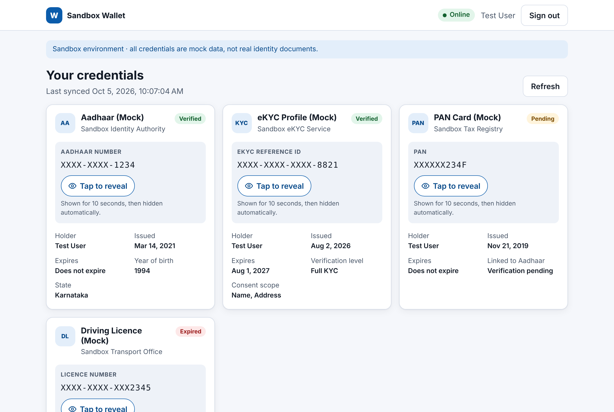

# Sandbox Credential Wallet (PWA)

Frontend assignment for the **UIDAI Sandbox — Frontend Developer** role.
A Progressive Web App where a test user signs in, views simulated identity credentials
(mock Aadhaar, eKYC, PAN, Driving Licence) and securely reveals sensitive values.

> All data is mock data. Nothing here is a real identity document.

**Stack:** Angular 22 (standalone components, Signals, zoneless) · NgRx Store + Effects · TypeScript ·
SCSS · vanilla Service Worker · Vitest + Angular Testing Library · Playwright + axe-core



## Quick start

```bash
npm install
npm start            # dev server on http://localhost:4200  (OTP: 123456)
npm test             # 27 unit/component tests (Vitest + Angular Testing Library)
npm run serve:pwa    # production build + static server on :8080 (Service Worker active)
npm run e2e          # 9 Playwright tests: offline SW cache + axe WCAG scans
```

Force each UI state with a query param or the **Sandbox controls** panel on the dashboard:
`?mock=success` (default) · `?mock=empty` · `?mock=error`.

## Where each part lives

| Assignment part | Files |
|---|---|
| **1. Dashboard + state management** | `src/app/features/dashboard/*`, `src/app/state/credentials/*` (actions, `createFeature` reducer + selectors, functional effects), `src/app/core/api/*` (API service + mock interceptor for `GET /api/credentials`) |
| **2. SecureDataMask (a11y)** | `src/app/shared/secure-data-mask/*`, `src/app/shared/utils/mask.ts` |
| **3a. Offline Service Worker** | `public/sw.js`, `src/app/core/pwa/*`, `public/manifest.webmanifest` |
| **3b. Automated tests** | `secure-data-mask.component.spec.ts` (the timeout test), plus reducer, effects, dashboard and mask-util specs; `e2e/offline.spec.ts`, `e2e/a11y.spec.ts` |

## Design notes

### 1. State management (NgRx)
- `credentialsFeature` holds `{ credentials, status, error, source, syncedAt }`.
- `selectViewState` derives a **discriminated union** — `loading | error | empty | loaded` — so the
  template can never show two states at once. A failed *refresh* keeps the last good list and shows a
  warning instead of blanking the screen.
- `loadCredentials` effect uses `switchMap` (a second Refresh cancels the first request) and maps errors to
  short user-facing messages. `syncOnReconnect` re-fetches on the browser `online` event.
- Logout dispatches `userLoggedOut`, which resets the slice (identity data leaves memory) and tells the SW
  to delete its cached copy.

### 2. SecureDataMask
- Masked by default (`XXXX-XXXX-1234`); the full value is **never in the DOM** while masked.
- **Tap to reveal** stores the plain value in a private `revealedValue` signal and starts a `setTimeout`.
  After 10 s (configurable) the timeout sets it back to `null` and clears the countdown interval.
- Also re-masks on manual hide, when the tab is hidden (`visibilitychange`), when the input value changes, and
  on destroy — no leaked timers.
- **Accessibility:** native `<button>` (Tab / Enter / Space, 44 px target, visible focus ring); accessible
  name `"Tap to reveal Aadhaar number"` contains the visible label (WCAG 2.5.3); `aria-controls` +
  `aria-describedby`; a polite `role="status"` live region announces reveal **and** automatic re-mask;
  masked glyphs are `aria-hidden` with a spoken summary (“ends in 1 2 3 4”); decorative countdown respects
  `prefers-reduced-motion`.

### 3. Offline
- `public/sw.js` intercepts `GET …/api/credentials` with **network-first** (4 s timeout). Successful
  responses are stored in Cache Storage under one key = “last known list”. Offline/timeout/5xx → serve the
  cached copy with `X-Cache-Source: sw-cache` + `X-Cached-At`, which the app turns into an
  “You're offline — showing data saved on …” banner. No cache → `503` + `X-Offline: true` → Error state.
- App shell: network-first navigations with cached `index.html` fallback; stale-while-revalidate for assets.

### Production hardening (out of scope for the mock)
Encrypt the cached payload (WebCrypto, key held in memory / non-extractable) or cache only masked values,
fetch the plain identifier on demand from a reveal endpoint with step-up auth, add a strict CSP, and send
reveal events to an audit log (the component already emits `revealedChange`).

## Deployment
`.github/workflows/deploy-pages.yml` publishes to GitHub Pages on every push to `main`
(hash routing, so no server rewrites are needed). `.github/workflows/ci.yml` runs unit + e2e tests.

---
Aditi Sengupta
